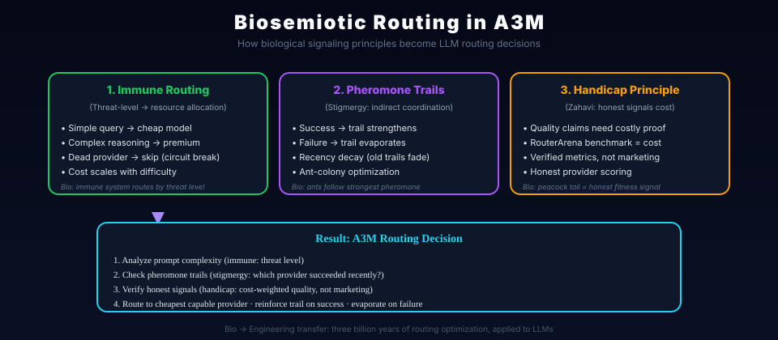

# A3M Router — LLM Routing That Cuts Your AI Bill by 90%



> **GPT-4o costs $0.03/run. A3M routes the same request to Groq/Mistral for $0.0001.** Same API. 99.7% cheaper. Self-hosted. No vendor lock-in.

[](https://www.npmjs.com/package/adaptive-memory-multi-model-router)
[](https://www.npmjs.com/package/adaptive-memory-multi-model-router)
[](https://pypi.org/project/a3m-router/)
[](LICENSE)
[](https://github.com/Das-rebel/a3m-router/stargazers)
[](https://github.com/Das-rebel/a3m-router/actions)

---

## ⚡ Why A3M Router?

Most requests don't need GPT-4o. A simple question costs the same as a complex one. A3M analyzes your prompt and routes to the **cheapest provider that can answer it correctly** — automatically.

| Feature | A3M Router | LiteLLM | Portkey | OpenRouter |
|---------|------------|---------|---------|------------|
| Self-hosted | ✅ | ✅ | ❌ | ❌ |
| Cost-aware routing | ✅ | ⚠️ | ✅ | ✅ |
| Latency SLO routing | ✅ | ❌ | ⚠️ | ❌ |
| Circuit breaker per model | ✅ | ❌ | ✅ | ❌ |
| Token optimization (cache/compress) | ✅ | ❌ | ❌ | ❌ |
| Personal agent router (learns) | ✅ | ❌ | ❌ | ❌ |
| Biosemiotic routing (pheromone) | ✅ | ❌ | ❌ | ❌ |
| OpenAI-compatible proxy | ✅ | ✅ | ✅ | ✅ |
| Free tier (no signup) | ✅ | ❌ | ❌ | ✅ |

---

## 🚀 Get Started in 30 Seconds

```bash
npm install adaptive-memory-multi-model-router
npx a3m-router serve
```

```python
from openai import OpenAI
client = OpenAI(base_url="http://localhost:8787/v1", api_key="not-needed")

response = client.chat.completions.create(
    model="auto",  # routes to cheapest capable provider
    messages=[{"role": "user", "content": "Write a Python fibonacci function"}]
)
print(response.choices[0].message.content)
# Output: GPT-4o quality, DeepSeek/Groq price
```

---

## 💰 Why Your AI Costs Too Much

| Query | GPT-4o | A3M Routes To | You Save |
|-------|--------|---------------|----------|
| "What is 2+2?" | $0.03 | Groq ($0.0001) | **99.7%** |
| "Explain quantum" | $0.03 | Mistral ($0.0002) | **99.3%** |
| "Write a Python function" | $0.05 | DeepSeek ($0.002) | **96%** |
| Complex reasoning | $0.15 | GPT-4o ($0.15) | **0%** (correctly routed) |

A3M analyzes your prompt and routes to the cheapest provider that can answer it correctly.

---

## 🔄 How Routing Works

```
Your Request
     │
     ▼
┌─────────────────┐
│  Semantic Cache │  ← "Seen this before?" (free hit, 0ms)
└────────┬────────┘
     ▼
┌─────────────────┐
│  Token Optimizer│  ← compress + stratify context (20-40% savings)
└────────┬────────┘
     ▼
┌─────────────────┐
│  Cost-Aware     │  ← cheapest capable provider for THIS prompt
│  Router         │
└────────┬────────┘
     ▼
┌─────────────────┐
│  Circuit Breaker│  ← skip dead providers, retry on failure
└────────┬────────┘
     ▼
┌─────────────────┐
│  Provider       │  ← Groq / Mistral / DeepSeek / GPT-4o / Claude...
└─────────────────┘
```

**Modes:**
- `model="auto"` — Heuristic router, ~0.4ms overhead, zero extra cost
- `model="jev-auto"` — ML decision head, calibrated probabilities, ~2ms warm
- `model="llm-bridge"` — unified facade with circuit breaking + cost budget caps

---

## 🧬 Biosemiotic Routing (The Science)

A3M is built on **biological intelligence** — evolution solved routing 3 billion years ago:

| Principle | Biology | A3M Implementation |
|-----------|---------|-------------------|
| **Immune Routing** | Threat level → resource allocation | Simple query → cheap model; complex → premium |
| **Pheromone Trails** | Ants follow strongest scent | Success reinforces provider trail; failure evaporates it |
| **Handicap Principle** | Peacock tail = honest fitness signal | Costly benchmarks verify quality claims (RouterArena) |

**Result:** Three billion years of routing optimization, applied to LLMs.

---

## 🌐 80+ Providers, Zero Config

```bash
npx a3m-router providers list
```

| Tier | Examples |
|------|----------|
| Free | Ollama, Llama.cpp, HuggingFace Inference |
| Budget | Groq, DeepSeek, Mistral, Cloudflare Workers AI |
| Mid | GPT-4o-mini, Claude-haiku, Gemini-flash |
| Premium | GPT-4o, Claude-sonnet, Gemini-pro |

Provider availability checked at runtime — no hardcoded uptimes.

---

## 🎯 Use Cases

- **AI features on a budget** — route 90% of traffic to Groq/DeepSeek, keep GPT-4o only for hard queries
- **Fallback resilience** — if Groq is down, A3M routes to Mistral automatically (circuit breaker per model)
- **Cost dashboards** — per-route savings vs baseline GPT-4o, tracked in real time
- **Semantic caching** — identical prompts cost $0 on repeat (free cache hit)
- **Multi-agent orchestration** — parallel ensemble with MC Dropout uncertainty
- **Voice pipelines** — Whisper transcription → route → TTS, all self-hosted

---

## 📦 Ship in Minutes, Not Days

**Drop-in OpenAI replacement:**
```python
client = OpenAI(base_url="http://localhost:8787/v1", api_key="not-needed")
```

**Or use the full API:**
```python
from a3m.router import A3MRouter

router = A3MRouter(
    model="auto",
    parallel_ensemble=3,  # Call 3 providers, take the best
    memory={"type": "semantic", "window": 10},
)

result = router.route(messages=[{"role": "user", "content": "..."}])
print(f"Provider: {result.provider}")
print(f"Cost: ${result.cost}")
```

**Self-hosted, no lock-in:**
```bash
docker run -p 8787:8787 ghcr.io/das-rebel/a3m-router:latest
# Or: npm install adaptive-memory-multi-model-router
```

No API key to share. No vendor lock-in. Your prompts stay on your infrastructure.

---

## 🛠️ CLI Reference

```bash
npx a3m-router serve              # Start server (port 8787)
npx a3m-router route "prompt"    # Preview routing decision
npx a3m-router health            # Live provider availability
npx a3m-router benchmark         # Local quality benchmark
npx a3m-router providers list    # Show all providers
```

**Environment variables:**
```bash
A3M_LOG_LEVEL=debug    # Debug logging
PORT=8787              # Server port
A3M_JEV_URL=...        # Optional: remote Jev ML backend
```

---

## 📊 A3M Router Impact

| Metric | Lifetime | Last 30 days | Last week |
|--------|----------|-------------|-----------|
| npm downloads | **49,493** | 12,710 | 2,149 |
| GitHub Stars | 18 | 2 | — |
| Forks | 5 | 0 | — |

---

## ⚠️ The Fine Print

**Works great when:**
- You're building AI features and need cost control
- You want fallback providers (if Groq is down, we route elsewhere)
- You need semantic caching across conversation turns
- You want to compare provider quality on the same prompts

**Not the right tool when:**
- You need exactly GPT-4o for every request (then just use GPT-4o)
- Your infrastructure can't run a local service

---

## 🤝 Contributing

See [CONTRIBUTING.md](CONTRIBUTING.md) for setup, project structure, and code conventions.

- [Issue Tracker](https://github.com/Das-rebel/a3m-router/issues)
- [Discussions](https://github.com/Das-rebel/a3m-router/discussions)
- [Changelog](CHANGELOG.md)

---

## 🧠 Ensemble Engine + MC Dropout

**Sep 2026** — Parallel ensemble execution for multi-model routing:

- `ParallelExecutor` (520 lines): Concurrent dispatch, retry logic, Shapley credit assignment, semantic clustering
- `mcDropout.ts` (157 lines): MC Dropout uncertainty estimation, stochastic forward passes
- Build verified (`npm run build` passes)
- Tests: 2/2 passing

**Key Features:** Confidence-weighted voting, loyalty/handicap tracking, provenance headers (`X-Ensemble-Provenance`), multi-strategy (majority/weighted/shapley/semantic)

---

## ⭐ Star History

[](https://star-history.com/#Das-rebel/a3m-router&Timeline)
EOF
echo "written"